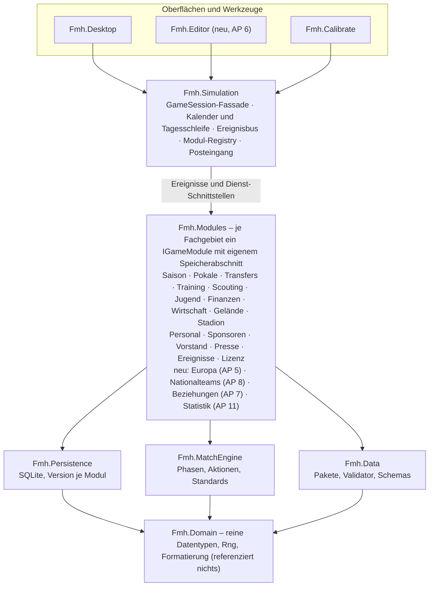

# FMH – Umsetzungskonzept für die KI

> Abgelegt aus dem Konzeptdokument des Projektinhabers (Stand 27.10.2026). Maßgeblich ist die jeweils aktuelle Fassung des Dokuments; diese Datei dient als Arbeitskopie im Repository.

2026-10-27 · @Nils

## 1. Zweck und Arbeitsregeln

Dieses Dokument ist der Auftrag an eine KI (z. B. Claude Code), die FMH von „Deutschland, 2 Ligen, Phase 3" zu einem modularen, europaweiten Open-Source-Manager weiterentwickelt. Es legt Reihenfolge, Architektur, Umfang und Abnahmekriterien fest; Details der Spielmechanik regelt weiter das Fachkonzept „Fußball-Manager (Textmodus)".

**Leitziele (vom Projektinhaber vorgegeben)**

- Spielgefühl wie Anstoß 3, Tiefe wie Football Manager, Spieltag nur als Text (Kommentar, Ticker, Konferenz), kein 3D.
- Open Source, modular, Ligaformate per Daten-Update änderbar.
- Alle europäischen Ligensysteme abbildbar, Hauptligen spielbar bis einschließlich 4. Liga.
- Datenbank-Editor mit maximaler Anpassungsfreiheit.
- Einstellungen individuell je (menschlichem) Spieler, Vereinsgelände individuell bebaubar.
- Frauenfußball als eigene Welt; als Vereinsmanager steuert man Männer- und Frauenbereich desselben Vereins parallel, Mitarbeiter können zwischen den Welten wechseln.
- Anstoß-Elemente (Satire, Privatleben, Grauzonen) sind ausdrücklich erwünscht, aber optional und abschaltbar.

**Arbeitsregeln für die KI**

1. Arbeite ausschließlich auf Feature-Branches, abgezweigt von `master`. Ein Arbeitspaket (AP) = ein Branch = ein Pull Request.
2. Lies vor jedem AP die betroffenen Dateien vollständig und die zugehörigen Tests. Rate keine Signaturen.
3. Kein AP ohne Tests: Jede neue Regel bekommt mindestens einen Unit-Test, jede neue Seite einen Headless-UI-Test.
4. Determinismus ist Pflicht. Jeder Zufall läuft über `Rng` mit Seed; keine `System.Random`, keine Uhrzeit in der Spiellogik.
5. Spielregeln, Zahlen und Texte gehören in Datenpakete (`data/`), nicht in C#. Neue Länder oder Wettbewerbe dürfen keinen Code mit Ländercodes wie `"DE1"` erfordern.
6. Jede Schemaänderung am Spielstand = neue `SchemaVersion` + Migration + Test, der einen Spielstand der Vorversion lädt.
7. Nach jedem AP laufen `dotnet build`, `dotnet test` und der Kalibrierungslauf (`fmh-calibrate --matches 10000` und `--season --seasons 5`). Kennzahlen dürfen die Toleranzen aus Abschnitt 8 nicht verlassen.
8. Alle Texte über Sprachschlüssel in `lang/de.json` und `lang/en.json`; der Sprachtest muss grün bleiben.
9. README und Kapitel-Tabelle („Umfang nach Kapiteln") im selben PR aktualisieren.
10. Bei unklaren fachlichen Entscheidungen nicht raten: die Frage als offenen Punkt im PR beschreiben und mit der konservativsten Variante weiterarbeiten.

## 2. Ist-Stand

Der spielbare Stand liegt nur im Branch `phase1-prototyp` (9 Commits, 25.–27.10.2026, ~39.600 Zeilen in 188 Dateien); `master` enthält nur den Initial-Commit von 2017. Build und Tests wurden für dieses Konzept nicht ausgeführt, die Bewertung ist statisch aus Code und README.

| Projekt | Zeilen ca. | Inhalt |
|---|---|---|
| `src/Fmh.Core` | 10.700 | Modell, `GameSession` (17 Teil-Dateien, ~5.300 Zeilen), Logik, SQLite-Speicher, Datenpakete |
| `src/Fmh.MatchEngine` | 1.500 | Text-Matchengine auf 5x7-Zonen (`MatchSimulation.cs` allein 1.374 Zeilen), Kommentar |
| `src/Fmh.Desktop` | 8.600 | Avalonia 11.3, MVVM (CommunityToolkit), 20 Seiten |
| `src/Fmh.Calibrate` | 300 | CLI für Engine- und Karriere-Kalibrierung |
| `tests/Fmh.Tests` | 2.600 | xUnit, ca. 100 Tests inkl. Avalonia Headless |
| `data/base` | 440 KB JSON | 1 Land (DE), 64 Vereine, 166 Ereignisse, 83 Gebäude, 24 Rollen, 25 Formationen, de/en |

Technik: .NET 10, C# mit Nullable, SQLite-Spielstände (Schemaversion 5 mit Migrationen), deterministischer xoshiro-`Rng`, Datenpakete mit `dependsOn` und Überlagerung, `DataValidator` beim Start.

**Strukturelle Schwächen, die vor weiterem Ausbau zu beheben sind**

- `GameSession` ist ein Gott-Objekt: jede Funktion (Finanzen, Transfers, Jugend, Lizenz, Presse …) hängt als `partial` an derselben Klasse und teilt deren Zustand.
- `MatchSimulation` ist ein Monolith ohne innere Aufteilung in Phasen, Aktionen und Standards.
- Europapokale werden nur ausgewürfelt (Stärke gegen Teilnehmerfeld), es gibt keine ausländischen Vereine.
- Kein Editor, keine Lizenzdatei, keine CI, `TreatWarningsAsErrors=false`.
- Vereinzelt Ländercodes im Code (z. B. `"DE1"` in `Fmh.Calibrate/Program.cs`).

## 3. Feature-Abgleich mit Football Manager und Anstoß

FMH deckt den Kern eines Managers bereits breit ab; es fehlen vor allem die Welt (weitere Länder, echte Europapokale, Nationalteams), das Menschliche im Kader (Zufriedenheit, Gespräche, Teamdynamik) und die Werkzeuge (Editor, Hot-Seat). Abgeglichen wurde mit der Football-Manager-Reihe (Sports Interactive) und der Anstoß-Reihe, vor allem Anstoß 3; die Vergleichsmerkmale stammen aus allgemeiner Genrekenntnis, nicht aus einer aktuellen Recherche.

**Bereits vorhanden und genrekonform:** Text-Matchengine mit Kommentar, Ticker und Konferenz; 44 Attribute mit versteckten Werten; Training mit Individualtraining und Umschulung; Taktik mit 25 Formationen, 24 Rollen und Standards; Transfers, Leihen, Vorverträge, Klauseln; Scouting mit Kenntnisstand; Pokal und Relegation; Finanzen mit Bank, Lizenzierung und FFP; Stadion inkl. Neubau; Vereinsgelände mit 83 Gebäuden (Anstoß-Stärke); Personal, Sponsoren, Vorstand, Fans, Presse; 166 Zufallsereignisse; Managerkarriere mit Trainerlizenzen und Jobangeboten; Nachwuchsleistungszentrum.

### Fehlt

| Feature | Vorbild | Priorität | Umsetzung in AP |
|---|---|---|---|
| Weitere Länder mit Pyramiden bis zur 4. Liga, inkl. regionaler Staffeln | FM, Projektziel | Muss | AP 3, AP 4 |
| Echte Europapokale mit ausländischen Vereinen, Ligaphase und K.-o.-Runden, Koeffizienten | FM, Anstoß 3 | Muss | AP 5 |
| Datenbank-Editor (Vereine, Spieler, Ligen, Regeln) | FM Pre-Game Editor, Anstoß-Editor, Projektziel | Muss | AP 6 |
| Spielerzufriedenheit, Spielergespräche, Versprechen (Einsatzzeit, Transfers, Vertrag) | FM | Muss | AP 7 |
| Testspiele und Vorbereitungsplanung | FM, Anstoß | Muss | AP 9 |
| Hot-Seat für mehrere menschliche Manager mit eigenen Einstellungen | Anstoß 3, Projektziel | Muss | AP 10 |
| Teamdynamik: Hierarchie, Grüppchen, Mannschaftsrat, Mentoring junger Spieler | FM | Soll | AP 7 |
| Nationalmannschaften, Länderspielpausen, Abstellungen, Manager als Nationaltrainer | FM, Anstoß 3 | Soll | AP 8 |
| Zweite Mannschaften (U21/U23) im Ligabetrieb, Spielrecht nach Landesregel | FM | Soll | AP 3 |
| Urlaub bzw. Delegation an Assistenten bis zu einem Datum | FM | Soll | AP 11 |
| Datenzentrale: Saison-Statistiken je Spieler und Team, Vergleich zweier Spieler, Gegneranalyse über mehrere Spiele | FM | Soll | AP 11 |
| Schnellsaison und Herausforderungen (Roadmap Phase 4) | FM | Soll | AP 12 |
| Einstiegshilfe: Tutorial, kontextuelle Tipps, Assistenten-Hinweise | FM | Soll | AP 12 |
| Frei belegbare Tasten, Barrierefreiheit (Kontrast, Schriftgröße, Screenreader-Namen) | Genre-Standard | Soll | AP 12 |
| Anstoß-Elemente: Privatleben des Managers, Grauzonen mit Aufdeckungsrisiko, Satire-Ereignisse (einzeln abschaltbar) | Anstoß-Reihe | Soll | AP 13 |
| Frauenfußball als eigene Welt, im selben Verein parallel zum Männerbereich steuerbar, Personal wechselt zwischen den Welten | neuere FM-Teile | Soll | AP 15 |
| Mod-Verwaltung im Spiel (Pakete an- und abwählen, Reihenfolge, Konflikte) | FM Workshop | Kann | AP 14 |
| Online-Hot-Seat (einzige denkbare Online-Variante, kein eigener Online-Modus) | FM | Kann | nicht geplant |

### Teilweise vorhanden

| Feature | Ist | Lücke |
|---|---|---|
| Europapokal | Qualifikation, Zulassung, Prämien; Weiterkommen per Stärkevergleich | Keine Spiele, keine Gegner (→ AP 5) |
| Nationalspieler | Nur Zufallsereignis „Nominierung" | Kein Spielbetrieb, keine Ausfälle (→ AP 8) |
| Spielerpersönlichkeit | Versteckte Werte (u. a. Professionalität) | Keine sichtbare Persönlichkeit, kein Einfluss auf Gespräche (→ AP 7) |
| Berater | Beraterhonorar in Verhandlungen | Keine Berater als Akteure mit Mandanten (→ AP 7) |
| Historie | Tabelle `history`, Ruhmeshalle des Managers | Keine Vereins- und Ligarekorde, keine Spielerkarriere-Seite (→ AP 11) |
| Einstellungen je Spieler | Schwierigkeit beim Start, Optionen global | Nur ein menschlicher Manager (→ AP 10) |
| Modding | Datenpakete mit Überlagerung, Validierung | Kein Editor, keine Paketverwaltung in der Oberfläche (→ AP 6, AP 14) |
| Trainingsrückmeldung | Fortschritt nach Alter, Potenzial, Trainern | Kein Bericht des Co-Trainers mit Empfehlungen (→ AP 11) |

## 4. Zielarchitektur

`GameSession` wird zu einer dünnen Fassade über eigenständigen Spielmodulen, die nur über Ereignisse und Schnittstellen miteinander sprechen; das Verhalten des Spiels darf sich dabei nicht ändern.



Oberflächen sprechen nur mit der Fassade; Module kennen einander nicht direkt, sondern nur über Ereignisse und schmale Dienste.

### 4.1 Projekte

| Projekt | Inhalt | Darf referenzieren |
|---|---|---|
| `Fmh.Domain` | Reine Datentypen aus `Model/` und `Match/MatchModels.cs`, `Rng`, `Fmt` | nichts |
| `Fmh.Data` | Datenpakete laden, überlagern, validieren (`Data/`) | Domain |
| `Fmh.Simulation` | Kalender, Tagesschleife, Ereignisbus, Modul-Registry, Fassade `GameSession` | Domain, Data |
| `Fmh.Modules.*` | Je Fachgebiet ein Projekt oder Namensraum (siehe 4.3) | Domain, Data, Simulation-Abstraktionen |
| `Fmh.Persistence` | `SqliteStore`, Migrationen, Speicherabschnitte der Module | Domain, Simulation-Abstraktionen |
| `Fmh.MatchEngine` | wie heute, intern aufgeteilt (4.4) | Domain |
| `Fmh.Desktop`, `Fmh.Editor`, `Fmh.Calibrate` | Oberflächen und Werkzeuge | alles außer anderen Oberflächen |

Ein Architekturtest (z. B. per Reflection über die Assembly-Referenzen) stellt sicher, dass diese Regeln eingehalten werden.

### 4.2 Modulvertrag

```csharp
public interface IGameModule
{
    string Id { get; }                       // "finance", "transfers" …
    IReadOnlyList<string> DependsOn { get; }  // bestimmt die feste Ausführungsreihenfolge
    void Register(ModuleContext ctx);        // Dienste anmelden, Ereignisse abonnieren
    void OnDay(DayContext day);              // täglicher Schritt, deterministisch
}

public interface ISaveSection             // jedes Modul besitzt seine Tabellen
{
    string ModuleId { get; }
    int Version { get; }
    void CreateSchema(SqliteConnection c);
    void Migrate(SqliteConnection c, int fromVersion);
    void Save(SqliteConnection c, World w);
    void Load(SqliteConnection c, World w);
}
```

- Ereignisse sind unveränderliche Records: `DayStarted`, `MonthStarted`, `MatchPlayed`, `PlayerTransferred`, `PlayerInjured`, `SeasonEnded`, `SeasonStarted`, `ManagerSacked` usw. Der Bus stellt sie in der Registrierungsreihenfolge zu, nie parallel.
- Querverweise laufen über schmale Dienst-Schnittstellen (`IFinanceService.Book(...)`, `ISquadQueries`), nie über fremden Modulzustand.
- Posteingang, Pflicht-Entscheidungen und Texte bleiben zentrale Dienste in `Fmh.Simulation`.
- Die Schemaversion des Spielstands wird zu einer Version je Modul (Tabelle `meta`: `schema.<modul>`). Die bestehende globale Version 5 gilt als Ausgangspunkt aller Module.

### 4.3 Schnitt der Module

Die heutigen Teil-Dateien werden 1:1 zu Modulen: Saison und Kalender, Pokale, Transfers (inkl. Verhandlungen), Training, Scouting, Jugend, Finanzen, Wirtschaft, Gelände, Stadionpläne, Personal, Sponsoren, Vorstand, Presse, Ereignisse, Lizenz. Neu hinzu kommen in späteren APs: Europa, Nationalteams, Spielerbeziehungen, Statistik.

**Welten und Mannschaften:** Damit Männer- und Frauenfußball (AP 15) sowie zweite Mannschaften (AP 3) sauber passen, wird schon in AP 1 zwischen `Club` und `Team` getrennt. Ein Verein besitzt mehrere Teams; jedes Team gehört genau einer Welt (`WorldId`: `men`, `women`) und einem Wettbewerbsstrang. Vereinsweite Module (Finanzen, Gelände, Stadion, Vorstand, Sponsoren, Personal) arbeiten auf dem Verein, mannschaftsbezogene Module (Kader, Training, Taktik, Transfers, Scouting, Jugend) auf dem Team.

### 4.4 Matchengine

`MatchSimulation.cs` wird in Phasensteuerung, Aktionen (Pass, Dribbling, Flanke, Schuss, Kopfball), Standards, Disziplin, Wechsel-KI und Zustandsmodell aufgeteilt. `IMatchEngine` bleibt die einzige Schnittstelle nach außen.

### 4.5 Vorgehen: Golden Master

1. Vor dem ersten Umbau einen Referenztest anlegen: Welt mit festem Seed erzeugen, drei Saisons simulieren, einen Hash über den kompletten Spielstand (alle Tabellen, sortiert) bilden und speichern. Ebenso für die Engine: 10.000 Spiele, Hash über alle Ergebnisse und Ereignisse.
2. Module einzeln herauslösen (Strangler-Muster), nach jedem Schritt muss der Hash identisch sein.
3. Erst wenn alle Module herausgelöst sind, darf der Golden Master bewusst neu gesetzt werden – nur in PRs, die eine Regeländerung ankündigen.

## 5. Arbeitspakete

Die Reihenfolge ist verbindlich bis AP 6; ab AP 7 dürfen Pakete parallel laufen, wenn ihre Voraussetzungen erfüllt sind. Jedes AP endet mit den Abnahmekriterien unten plus der Definition of Done aus Abschnitt 8.

### AP 0 – Konsolidieren

- `phase1-prototyp` nach `master` mergen, Branch-Schutz für `master` aktivieren.
- Lizenz: Open Source ist gesetzt, die konkrete Lizenz klärt der Projektinhaber später. Bis dahin im README nur der Hinweis „Lizenz folgt"; keine Lizenzdatei anlegen und keine fremden Inhalte mit unklarer Lizenz aufnehmen.
- GitHub Actions: Build und Test auf Linux und Windows, Kalibrierung als eigener Job mit Toleranzprüfung.
- `TreatWarningsAsErrors=true`, bestehende Warnungen beheben.
- Ländercodes aus C# entfernen (`"DE1"` in `Fmh.Calibrate`), stattdessen Ebene und Land aus den Daten lesen.
- **Abnahme:** CI grün auf beiden Systemen; `grep` nach `"DE` in `src/` liefert keine Treffer.

### AP 1 – GameSession modularisieren

- Golden-Master-Tests nach 4.5 anlegen.
- Projekte nach 4.1 anlegen, Modulvertrag nach 4.2 einführen, Module nach 4.3 einzeln herauslösen.
- Speicherabschnitte je Modul mit eigener Version, Migration vom globalen Schema 5.
- **Abnahme:** Golden Master unverändert; keine Datei in `Fmh.Simulation` über 400 Zeilen; Architekturtest grün; Spielstände der Version 5 laden.

### AP 2 – Matchengine aufteilen

- Aufteilung nach 4.4, Engine-Gewichte bleiben in `rules/engine.json`.
- **Abnahme:** Engine-Golden-Master identisch; keine Datei über 400 Zeilen; ≤ 3 ms je Spiel.

### AP 3 – Datenmodell für beliebige Ligapyramiden

Details in Abschnitt 6.

- **Abnahme:** Ein Testland mit 4 Ebenen, geteilter 4. Liga (3 Staffeln), Playoffs und zweiten Mannschaften läuft 5 Saisons ohne Validierungsfehler; Auf- und Abstiege bleiben teamzahlkonsistent.

### AP 4 – Länder-Datenpakete

- Pro Land ein eigenes Paket `data/<land>/` mit `dependsOn: ["base"]`, nur fiktive Vereins- und Personennamen.
- **Abnahme:** Alle Pakete bestehen `DataValidator`; Kalibrierung je Land innerhalb der Toleranzen; Ladezeit eines Spielstarts mit allen spielbaren Ländern unter 10 s.

### AP 5 – Echte Europapokale

- Drei Wettbewerbe (Champions-, Europa-, Conference-Pokal) mit Qualifikationsrunden, Ligaphase und K.-o.-Runde, Format als Daten in `data/base/competitions/europe.json`.
- Teilnehmer aus allen geladenen Ländern; Länder ohne spielbare Ligen liefern Hintergrundvereine (Abschnitt 6.4).
- Länderkoeffizienten über 5 Jahre bestimmen die Startplätze je Land; Vereinskoeffizient für Setzlisten.
- Spieltage in den Kalender einpassen (Dienstag bis Donnerstag), Belastung und Rotation wirken.
- Bestehende vereinfachte Simulation entfernen, Migration für laufende Spielstände.
- **Abnahme:** 10 simulierte Saisons: jede Runde hat korrekte Teilnehmerzahl; Koeffizienten verändern Startplätze; deutsche Vereine verpassen keine Ligaspiele durch Terminkollisionen.

### AP 6 – Datenbank-Editor

Details in Abschnitt 7.

### AP 7 – Spielerbeziehungen und Teamdynamik

- Zufriedenheit je Spieler aus Einsatzzeit gegen Kaderstatus, Gehalt gegen Teamgefüge, Vereinserfolg, gehaltene Versprechen.
- Spielergespräche mit Themen (Einsatzzeit, Leistung, Transferwunsch, Vertrag, Lob, Kritik), Antworten abhängig von Persönlichkeit.
- Versprechen mit Frist und Prüfung; gebrochene Versprechen senken Zufriedenheit und Vertrauen im Kader.
- Hierarchie (Führungsspieler, Etablierte, Mitläufer), Mannschaftsrat, Mentoring-Gruppen mit Wirkung auf versteckte Werte junger Spieler.
- Berater als Akteure mit Mandanten, Einfluss auf Wechselwünsche und Verhandlungen.
- **Abnahme:** Unzufriedene Spieler fordern messbar häufiger einen Wechsel; Mentoring verändert Professionalität junger Spieler über eine Saison nachweisbar; Kalibrierung: Anteil unzufriedener Spieler je Kader 5–20 %.

### AP 8 – Nationalmannschaften

- Nationalteams je Land als Daten, Länderspielfenster im Kalender, Nominierung durch KI nach Stärke und Form.
- Abstellungen mit Verletzungs- und Ermüdungsrisiko, Länderspiele werden mit der Engine im Schnellmodus gespielt.
- Turniere (EM, WM, Qualifikation) als Wettbewerbsformate in Daten; der Manager kann Nationaltrainer werden, auch neben dem Verein.
- **Abnahme:** Nominierte Spieler fehlen an Länderspieltagen nicht im Verein, sind danach aber müder; Turniere laufen vollständig durch.

### AP 9 – Testspiele und Vorbereitung

- Testspiele vereinbaren (Gegner, Ort, Einnahmenteilung), Turniere im Sommer, Trainingslager-Kopplung.
- **Abnahme:** Testspiele zählen nicht in Wettbewerbsstatistiken, verbessern Fitness und Taktikvertrautheit.

### AP 10 – Hot-Seat und Einstellungen je Manager

- Bis zu 4 menschliche Manager in einem Spielstand, jeder mit einem eigenen Verein; zwei Menschen dürfen nicht denselben Verein führen. Sie spielen gegeneinander (gleiche Liga, Transfers untereinander, direkte Duelle).
- „Weiter" springt erst, wenn alle bestätigt haben; Spieltage ohne eigene Beteiligung laufen im Sofortmodus. Spiele zweier Menschen gegeneinander: beide stellen vorher auf, das Spiel läuft einmal für beide.
- Einstellungen je Manager: Schwierigkeit, Anstoß-Elemente, Tonfall, Ereignishäufigkeit, Pressedelegation, Kommentarmodus, Farbthema, Sprache, Tastenbelegung.
- Kein eigener Online-Modus. Architektur aber so anlegen, dass später ein **Online-Hot-Seat** möglich ist (Züge reihum über einen geteilten Spielstand oder Server), das ist die einzige denkbare Online-Variante.
- **Abnahme:** 4 Manager mit 4 Vereinen spielen eine Saison; jeder sieht nur seinen Posteingang und seine verdeckten Infos (Scouting, Verhandlungen); Einstellungen bleiben nach Laden erhalten.

### AP 11 – Komfort und Analyse

- Urlaub bis Datum mit Delegation an Co-Trainer (Training, Aufstellung, Transfers optional).
- Datenzentrale: Statistiken je Spieler und Team über Saisons, Spielervergleich, Gegneranalyse über die letzten 5 Spiele.
- Historie: Vereins- und Ligarekorde, Spielerkarriere-Seite, Meisterchronik.
- Trainingsbericht des Co-Trainers mit Empfehlungen.

### AP 12 – Einstieg, Spielmodi, Zugänglichkeit

- Schnellsaison und Herausforderungen (z. B. „Klassenerhalt mit dem Letzten"), als Daten definiert.
- Tutorial mit geführten Schritten und abschaltbaren Tipps.
- Frei belegbare Tasten, Schriftskalierung, Kontrastthema, Namen für Screenreader (Avalonia `AutomationProperties`).

### AP 13 – Anstoß-Elemente

Ausdrücklich gewünscht, aber als Schalterbündel umgesetzt: jedes Element einzeln je Manager abschaltbar, dazu ein Hauptschalter „Anstoß-Modus". Voreinstellung bei neuem Spiel: an.

- **Privatleben des Managers:** Wohnung, Auto, Hobbys, Familie; wirkt auf Ansehen, Stress und Vorstandsvertrauen.
- **Grauzonen:** Schiedsrichter beeinflussen, verbotene Mittel, Spielertricks bei Vertragsverhandlungen; jeweils mit Aufdeckungsrisiko, Sperren, Geldstrafen, Entlassung.
- **Satirische Ereignisse und Presse:** der satirische Tonfall existiert bereits; zusätzlich Ereignisse mit Anstoß-Humor als eigenes Datenpaket `data/anstoss/`.
- **Kabinen- und Mannschaftsabende, Fanaktionen, Kuriositäten** als Ereignisse mit Wirkung auf Moral und Fans.
- Technisch: alle Inhalte als Daten mit Kennzeichen `"feature": "anstoss.<element>"`; ausgeschaltete Elemente werden weder ausgelöst noch angezeigt.
- **Abnahme:** Mit Hauptschalter aus ist der Golden Master identisch zum Spiel ohne Paket; jedes Element lässt sich einzeln schalten, auch im laufenden Spielstand.

### AP 14 – Veröffentlichung

- Mod-Verwaltung in der Oberfläche (Pakete wählen, Reihenfolge, Konflikte anzeigen).
- Self-contained Builds für Windows, Linux, macOS per CI, Versionsnummern nach SemVer, Changelog.

### AP 15 – Frauenfußball als eigene Welt

Voraussetzung: AP 1 (Trennung `Club`/`Team`), AP 3 und AP 6.

- **Eigene Welt:** eigene Ligen, Pokale, Europapokale und Nationalteams als Datenpakete (`data/<land>-women/`), eigener Spielerinnen-Pool, eigener Transfermarkt, eigene Engine-Kalibrierung über `rules/engine.json` je Welt.
- **Ein Verein, zwei Abteilungen:** Vereine können in beiden Welten ein Team haben. Gemeinsam sind Name, Wappen, Kasse, Vereinsgelände, Stadion (mit Belegungsplan), Vorstand und Fans; getrennt sind Kader, Training, Taktik, Liga und die Abteilungsbudgets.
- **Parallele Steuerung mit Fokus:** Der Mensch darf beide Abteilungen gleichzeitig führen. Dann wirkt er als Vereinsmanager und muss nicht alle Spiele selbst bestreiten: Je Abteilung legt er fest, ob er Spiele selbst coacht, nur die Aufstellung macht oder alles dem Cheftrainer bzw. der Cheftrainerin (KI) überlässt. Umschalter Männer/Frauen in der Navigation, ein Posteingang mit Filter, ein Kalender; „Weiter" läuft bis zum nächsten Ereignis in einer Abteilung, die er selbst führt.
- **Fokus als Spielmechanik:** Wer beide Abteilungen führt, hat begrenzte Aufmerksamkeit. Die Abteilung im Fokus bekommt volle Wirkung von Ansprachen und Trainingsplanung; die andere nur eine reduzierte. Den Fokus kann man jederzeit wechseln.
- **Budgets mit dem Vorstand:** Zum Saisonstart werden Gesamtbudget und Abteilungsbudgets (Transfer, Gehalt, Betrieb je Männer und Frauen) gemeinsam mit dem Vorstand festgelegt. Die Männer dürfen die Frauen dabei subventionieren. Während der Saison gelten die Budgets als Zusage und sollen eingehalten werden.
- **Umschichtungen in der Saison:** Verschiebungen zwischen den Abteilungen sind ein Antrag an den Vorstand. Bleibt das Gesamtbudget eingehalten, stimmt er meist zu, lehnt aber manchmal ab (abhängig von Vorstandsvertrauen, Eigenschaften der Mitglieder und Lage der abgebenden Abteilung). Überschreitungen ohne Zustimmung kosten Vorstandsvertrauen.
- **Personal zwischen den Welten:** Mitarbeiter gehören dem Verein und sind einer Abteilung zugeordnet. Wechsel innerhalb des Vereins per Versetzung, Abwerbung zwischen Vereinen über beide Welten hinweg. Fähigkeiten und Erfahrung gelten in beiden Welten, mit Eingewöhnungszeit nach einem Wechsel. Doppelfunktion ist erlaubt: Ein Mitarbeiter kann beide Abteilungen betreuen, z. B. ein Arzt. Ab einer bestimmten Ligaebene müssen die meisten Rollen aber je Team dediziert besetzt sein. Welche Rollen ab welcher Ebene teilbar bleiben, steht als Regel `staffSharing` in den Länderdaten (je Ebene: teilbare Rollen, Abschlag bei Doppelfunktion); verstößt ein Verein dagegen, gibt es eine Lizenzauflage bzw. Vorstandskritik statt eines harten Verbots.
- **Gründung:** Vereine ohne Frauenteam können eines gründen und starten in der untersten spielbaren Liga; KI-Vereine tun das nach Größe und Finanzlage.
- **Abnahme:** Ein Vereinsmanager führt beide Teams eine Saison lang parallel, coacht nur die Spiele einer Abteilung selbst, und es gibt keine Terminkollision im Stadion; ein Umschichtungsantrag bei eingehaltenem Gesamtbudget wird in einem Testlauf über 100 Anträge in 70–90 % der Fälle angenommen; ein Co-Trainer wird von den Männern zu den Frauen versetzt und wirkt danach dort.

## 6. Europäische Ligensysteme bis zur 4. Liga

Das heutige Länderschema (`countries/de.json`) trägt bereits Ebenen, Staffeln, Playoffs und `validFrom`; es muss um Staffelzuteilung, frei definierbare Auf- und Abstiegsregeln, geteilte Saisons und zweite Mannschaften erweitert werden. Dass Formate sich laufend ändern, zeigt Deutschland: Der DFB plant, die Regionalliga ab 2028/29 auf vier Staffeln à 20 Vereine umzustellen, mit 2027/28 als Qualifikationssaison; entscheiden soll ein außerordentlicher Bundestag am 18.12.2026 ([DFB](https://www.dfb.de/news/regionalliga-reform-dfb-praesidium-bereitet-ausserordentlichen-bundestag-vor)). Genau solche Änderungen müssen als reines Daten-Update einspielbar sein.

### 6.1 Schema-Erweiterungen

- **Staffeln:** `division.groups` mit `assignment`: `fixed` (Liste), `geographic` (Vereine tragen `region` und Koordinaten, Zuteilung jede Saison neu) oder `rotating`.
- **Bewegungsregeln statt Sonderfelder:** `movements: [{ from: "DE3", positions: "1-2", to: "up", kind: "direct" }, { positions: "3", kind: "playoff", playoff: "DE-REL2" }]`. Die heutigen Felder `promotion`/`relegation` werden per Migration darauf abgebildet.
- **Playoff-Formate:** einfach, Hin- und Rückspiel, Mini-Turnier mit Halbfinale und Finale, Gruppenzweiten-Vergleich, „Quotientenregel" bei ungleich großen Staffeln. Beispiel Spanien: In der Segunda Federación (5 Staffeln à 18) steigen die Meister direkt auf, Platz 2–5 spielen Playoffs, die letzten fünf steigen ab und die vier Dreizehnten spielen zwei weitere Absteiger aus ([Wikipedia](https://en.wikipedia.org/wiki/2025%E2%80%9326_Segunda_Federaci%C3%B3n)).
- **Saisonphasen:** `phases` innerhalb einer Saison, z. B. Grunddurchgang, dann Meister- und Abstiegsrunde mit Punkteübernahme (`pointsCarry`: 1,0 oder 0,5, Rundung definierbar).
- **Zweite Mannschaften:** `reserveOf: <clubKey>`, Regel `maxLevelBelowFirstTeam`, kein Aufstieg in die Liga der ersten Mannschaft, Spielrechtsregeln (Altersgrenze, Anzahl Ältere) je Land.
- **Gültigkeit:** jede Formatversion mit `validFrom`/`validTo`; beim Saisonwechsel wählt der Kalender die passende Version. Übergangsregeln (Sonderabsteiger) als eigene `movements` mit `onlySeason`.
- **Validierung:** `DataValidator` prüft für jede Saison der Gültigkeitsspanne, dass Zu- und Abgänge je Ebene aufgehen und jede Bewegungsregel ein Ziel hat.

### 6.2 Aktivierungsstufen je Land

| Stufe | Bedeutung | Simulation |
|---|---|---|
| `Playable` | Alle Ebenen bis 4 spielbar, volle Kader | Engine im Sofortmodus für Spiele ohne Zuschauer, voller Modus bei Beobachtung |
| `Background` | Nur Ebene 1–2 mit vollen Kadern, Rest als Tabelle | Schnelles Ergebnismodell aus Teamstärken, deterministisch |
| `EuropeOnly` | Nur Vereine, die Europapokal spielen können | Spieler erst bei Bedarf erzeugt (Schattenkader, Seed je Verein) |

Der Spieler wählt beim Spielstart je Land die Stufe; der Editor kann sie ändern. Ziel: Spieltag mit allen `Playable`-Ländern unter 5 s, Speicherstand unter 300 MB.

### 6.3 Länderwellen

| Welle | Länder | Stufe |
|---|---|---|
| 1 | Deutschland (Ausbau um 3. Liga und Regionalligen), England, Spanien, Italien, Frankreich | Playable |
| 2 | Niederlande, Portugal, Belgien, Türkei, Österreich, Schweiz, Schottland | Playable |
| 3 | Alle übrigen UEFA-Verbände | Background bzw. EuropeOnly |

Formate der ersten Welle, Stand vor Umsetzung je Land erneut zu prüfen:

| Land | Ebene 1 | Ebene 2 | Ebene 3 | Ebene 4 | Hinweis |
|---|---|---|---|---|---|
| Deutschland | 18 | 18 | 20 | Regionalliga, 5 Staffeln | Reform auf 4 × 20 ab 2028/29 geplant (s. o.) |
| England | 20 | 24 | 24 | 24 | Ebene 5 als Pool für Auf- und Abstieg |
| Spanien | 20 | 22 | Primera Federación, 2 Staffeln | Segunda Federación, 5 × 18 | Ebene 3 Teamzahl prüfen |
| Italien | 20 | 20 | Serie C, 3 Staffeln | Serie D, mehrere Staffeln | Ebene 4 Staffelzahl prüfen |
| Frankreich | 18 | 18 | National | National 2 | Teamzahlen prüfen, Quellen widersprüchlich |

Angaben ohne Quellenlink stammen aus allgemeiner Kenntnis und sind vor dem Anlegen der Daten zu verifizieren.

### 6.4 Namen und Rechte

Ausgeliefert werden nur fiktive Vereine, Spieler, Wettbewerbe und Sponsoren (wie heute „1. Liga", „Champions-Pokal"). Je Land kommt eine Namensliste `names/<land>.json`. Echte Daten kann jeder Nutzer per Editor als eigenes, nicht ausgeliefertes Paket anlegen.

### 6.5 Frauenwelt

Die Frauenwelt nutzt dasselbe Länderschema, aber eigene Dateien mit eigener Welt-Kennung (`"world": "women"`). Ein Verein ist über seinen `clubKey` in beiden Welten derselbe. Die Pyramiden sind meist flacher; die Zahl spielbarer Ebenen je Land wird bei der Datenanlage recherchiert und ist nicht an die „bis 4. Liga"-Vorgabe der Männerwelt gebunden.

## 7. Datenbank-Editor (AP 6)

Der Editor ist ein eigenes Programm `Fmh.Editor` (Avalonia, gleiche Themen und Bedienung wie das Spiel), das Datenpakete bearbeitet und nie die ausgelieferten Pakete selbst verändert: Jede Änderung landet in einem eigenen Paket, das per `dependsOn` über `base` gelegt wird.

### 7.1 Zwei Modi

1. **Paket-Modus (vor dem Spielstart):** bearbeitet JSON-Datenpakete; Ergebnis ist ein Ordner unter `data/<paketname>/`, teilbar als ZIP.
2. **Spielstand-Modus (optional, später):** bearbeitet einen laufenden SQLite-Spielstand. Der Spielstand wird danach dauerhaft als „bearbeitet" markiert; Erfolge der Ruhmeshalle sind dann gesperrt.

### 7.2 Bearbeitbare Bereiche

| Bereich | Inhalt | Besonderheit |
|---|---|---|
| Länder und Wettbewerbe | Pyramide, Staffeln, Bewegungsregeln, Playoffs, Pokale, Kalender, Transferfenster, Lizenzregeln, Formatversionen | Visuelle Pyramide; Live-Prüfung der Teamzahlen je Saison |
| Vereine | Name, Kürzel, Farben, Wappen (Vektor oder PNG), Region, Stadion, Gelände, Finanzen, Reputation, Rivalen, zweite Mannschaft | Massenbearbeitung per Tabelle |
| Spieler | Stammdaten, 44 Attribute, versteckte Werte, Positionen, Vertrag, Potenzial | Optional: nur Rahmen vorgeben, Rest generiert der Weltgenerator |
| Personal, Manager, Schiedsrichter | Stammdaten und Fähigkeiten | – |
| Regeln | `engine.json`, Rollen, Formationen, Gebäude, Verletzungen, Positionsgewichte | Warnung bei Engine-Werten, Kalibrierung aus dem Editor startbar |
| Inhalte | Zufallsereignisse, Pressefragen, Sponsoren, Namenslisten | Formular für Bedingungen und Wirkungen |
| Sprachen | Texte und Kommentarbausteine je Sprache | Fehlende Schlüssel und Platzhalter markiert |

### 7.3 Anforderungen

- Jede Eingabe wird sofort gegen `DataValidator` geprüft; Fehlerliste mit Sprung zum Feld. Speichern ist auch mit Fehlern möglich, Spielstart mit dem Paket nicht.
- Rückgängig und Wiederholen über alle Bereiche.
- Unterschiedsansicht: Was ändert mein Paket gegenüber `base`?
- Import und Export als CSV für Vereine und Spieler (Massendaten aus Tabellenkalkulation).
- Schema als JSON-Schema-Dateien unter `data/schema/`; Editor und Validator nutzen dieselben Schemas, damit auch Texteditoren Autovervollständigung bekommen.
- Probelauf: „Saison simulieren" mit dem bearbeiteten Paket direkt aus dem Editor, Ergebnis als Kennzahlen (Tore, Finanzen, Auf- und Abstiege).

### 7.4 Abnahme

- Ein Nutzer kann ohne Texteditor ein neues Land mit 4 Ebenen, 64 Vereinen und Pokal anlegen und damit ein Spiel starten.
- Die Regionalliga-Umstellung auf 4 Staffeln ab einer gewählten Saison lässt sich allein im Editor als neue Formatversion abbilden.
- Ein Paket aus dem Editor ist byte-identisch reproduzierbar (sortierte Schlüssel, feste Formatierung), damit Git-Diffs lesbar bleiben.

## 8. Qualität und Definition of Done

Ein AP ist erst fertig, wenn CI grün ist, die Kalibrierung in den Toleranzen liegt und README sowie Kapitel-Tabelle den neuen Stand beschreiben.

### 8.1 Kalibrierungstoleranzen

Zielwerte aus dem README (Kapitel 6 des Fachkonzepts); die CI bricht ab, wenn ein Wert die Toleranz verlässt.

| Kennzahl | Ziel | Toleranz |
|---|---|---|
| Tore pro Spiel | 2,8 | ± 0,15 |
| Unentschieden | 25 % | ± 2,5 Prozentpunkte |
| Heimsiege | 45 % | ± 2,5 Prozentpunkte |
| Gelbe Karten pro Spiel | 3,8 | ± 0,3 |
| Rote Karten pro Spiel | 0,2 | ± 0,05 |
| Verletzungen pro Team und Spiel | 0,3 | ± 0,05 |
| Laufzeit je Spiel | 2,5 ms | ≤ 3 ms |
| Ligastärke-Drift über 8 Saisons | heute +0,07 je Saison | ≤ 0,05 je Saison (offener Punkt aus README) |

Die Toleranzen sind ein Vorschlag dieses Konzepts und können vom Projektinhaber angepasst werden.

### 8.2 Tests

- Unit-Tests je Regel, Golden-Master-Tests für Welt und Engine, Migrationstest je Schemaversion, Headless-UI-Test je Seite.
- Datentests: jedes Paket unter `data/` besteht den Validator; jede Sprache hat alle Schlüssel.
- Langläufer (10 Saisons, alle Länder) nur nachts in der CI, nicht bei jedem PR.

### 8.3 Konventionen

- Code und Bezeichner Englisch, Kommentare und Doku Deutsch (wie heute).
- Keine Datei über 400 Zeilen in Kern und Modulen, keine Methode über 60 Zeilen; Ausnahmen begründen.
- Öffentliche Typen mit XML-Doku; `Nullable` an, Warnungen als Fehler.
- Commit-Nachrichten auf Deutsch im Imperativ, ein Thema je Commit.

### 8.4 Definition of Done je AP

- Branch von aktuellem `master`, PR mit Beschreibung, offenen Fragen und Screenshots betroffener Seiten
- Build und alle Tests grün auf Linux und Windows
- Golden Master unverändert oder Neusetzung im PR begründet
- Kalibrierung innerhalb der Toleranzen
- Neue Texte in `de` und `en`
- Schemaänderung mit Migration und Migrationstest
- README und Kapitel-Tabelle aktualisiert

## 9. Prompt-Vorlage je Arbeitspaket

Diesen Text pro AP an die KI geben; nur die Felder in spitzen Klammern ändern sich. Das Konzept liegt im Repo als `docs/umsetzungskonzept.md` (beim AP 0 dort ablegen).

```markdown
Du arbeitest am Open-Source-Fußball-Manager FMH (github.com/callahit/FMH, .NET 10, Avalonia, SQLite).
Verbindlich sind docs/umsetzungskonzept.md (Abschnitte 1, 4 und 8) und das README.

Auftrag: <AP-Nummer und Titel, z. B. "AP 5 – Echte Europapokale">
Umfang: siehe Abschnitt 5, <AP>; ergänzend Abschnitt <6 oder 7, falls relevant>.

Vorgehen:
1. Lies die betroffenen Dateien und Tests vollständig. Fasse in 5–10 Zeilen zusammen,
   was du ändern wirst und welche Dateien betroffen sind. Warte NICHT auf Freigabe,
   außer eine Entscheidung ist nicht umkehrbar (z. B. Spielstandformat ohne Migration).
2. Lege einen Branch ap<nr>-<kurzname> von master an.
3. Setze in kleinen Commits um. Nach jedem größeren Schritt: dotnet build, dotnet test.
4. Schreibe die Tests aus den Abnahmekriterien zuerst oder parallel.
5. Führe die Kalibrierung aus (fmh-calibrate --matches 10000 und --season --seasons 5)
   und vergleiche mit den Toleranzen in Abschnitt 8.1.
6. Aktualisiere README und die Kapitel-Tabelle.
7. Öffne einen PR mit: Zusammenfassung, Abnahmekriterien als Checkliste mit Ergebnis,
   Kalibrierungswerten vorher/nachher, offenen Fragen.

Grenzen:
- Keine Ländercodes oder Wettbewerbs-IDs im C#-Code; alles über Datenpakete.
- Jeder Zufall über Rng mit Seed.
- Keine echten Vereins-, Spieler- oder Sponsorennamen.
- Ändere nichts außerhalb des AP-Umfangs; Funde außerhalb als Issue notieren.
- Bei fachlicher Unklarheit: konservativste Variante wählen und im PR als offene Frage aufführen.
```

**Offene ****Fragen an den Projektinhaber (vor dem jeweiligen AP zu klären; bis dahin gilt der Vorschlag)**

| Nr. | Thema | Frage | Vorschlag | Vor AP |
|---|---|---|---|---|
| 1 | Lizenz | Welche Open-Source-Lizenz für Code und für Daten? (Klärt der Projektinhaber später.) | GPL-3.0 + CC BY-SA 4.0 | 14 |
| 2 | Lizenz | Sollen Beiträge Dritter eine Zustimmungserklärung (CLA/DCO) brauchen? | DCO (Signed-off-by) | 14 |
| 3 | Plattformen | Nur Windows oder auch Linux und macOS als fertige Builds? | Alle drei | 0, 14 |
| 4 | Qualität | Toleranzen aus 8.1 bestätigen oder anpassen? | wie 8.1 | 0 |
| 5 | Länder | Reihenfolge der Länderwellen in 6.3 bestätigen? | wie 6.3 | 4 |
| 6 | Europapokal | Fiktive Namen wie heute („Champions-Pokal") beibehalten? | ja | 5 |
| 7 | Editor | Spielstand-Modus (laufendes Spiel bearbeiten) gewünscht? Soll Bearbeiten die Ruhmeshalle sperren? | ja, sperrt | 6 |
| 8 | Echte Daten | Soll das Projekt Community-Pakete mit echten Namen verlinken oder nur fiktive Daten kennen? | nur fiktiv ausliefern, nichts verlinken | 6 |
| 9 | Anstoß-Elemente | Welche Elemente genau (Privatleben, Schiedsrichter beeinflussen, verbotene Mittel, Kneipe, Lotto/Aktien …)? Grenzen beim Grauzonen-Humor? | Liste in AP 13, Rest per Paket | 13 |
| 10 | Frauenfußball | Ab welcher Ligaebene müssen welche Rollen dediziert je Team sein, und welcher Abschlag gilt bei Doppelfunktion darunter? | Ebene 1–2: nur Arzt, Physiotherapeut, Platzwart und Pressesprecher teilbar; darunter alle Rollen teilbar; Abschlag 20 % je Abteilung | 15 |
| 11 | Frauenfußball | Gleiches Attributmodell und gleiche Matchengine mit eigener Kalibrierung, oder eigene Zielwerte (Tore, Karten)? | gleiches Modell, eigene Zielwerte | 15 |
| 12 | Frauenfußball | Welche Länder und wie viele Ebenen spielbar? Eigene Nationalteams und Turniere? | Welle 1 mit 2–3 Ebenen, Nationalteams ja | 15 |
| 13 | Frauenfußball | Wie stark sinkt die Wirkung in der Abteilung ohne Fokus? | 50 % bei Ansprachen und Trainingsplanung | 15 |
| 14 | Hot-Seat | Dürfen menschliche Manager im Laufe der Karriere den Verein eines anderen Menschen übernehmen, wenn dieser ihn verlässt? | ja, sobald er frei ist | 10 |
| 15 | Sprachen | Weitere Sprachen außer Deutsch und Englisch geplant? | erst nach AP 14, per Community | 14 |
| 16 | Vertrieb | Nur GitHub-Releases oder auch Plattformen wie itch.io oder Steam? | GitHub, später itch.io | 14 |
| 17 | Vorgehen | Wer prüft die Pull Requests der KI, und wie viele APs dürfen parallel offen sein? | Projektinhaber, max. 2 | 0 |

**Entschieden am 27.10.2026**

- Lizenz: Open Source; welche Lizenz, wird später geklärt.
- Anstoß-Modus ist bei neuem Spiel standardmäßig an, Elemente einzeln abschaltbar.
- Frauenfußball: Budgets werden mit dem Vorstand festgelegt, Männer dürfen Frauen subventionieren; in der Saison gelten die Budgets, Umschichtungen brauchen die Zustimmung des Vorstands (meist ja bei eingehaltenem Gesamtbudget, manchmal nein).
- Ein Mensch darf beide Abteilungen parallel führen, muss dann aber nicht alle Spiele selbst spielen und setzt einen Fokus.
- Hot-Seat: maximal 4 Personen mit unterschiedlichen Vereinen, die gegeneinander spielen.
- Kein eigener Online-Modus; einzig denkbar ist später ein Online-Hot-Seat.

- Personal darf beide Abteilungen betreuen (z. B. Ärzte); ab einem gewissen Ligeniveau sollen die meisten Rollen aber dediziert je Team besetzt sein.

Bis eine Frage beantwortet ist, arbeitet die KI mit dem Vorschlag und kennzeichnet ihn im PR.
